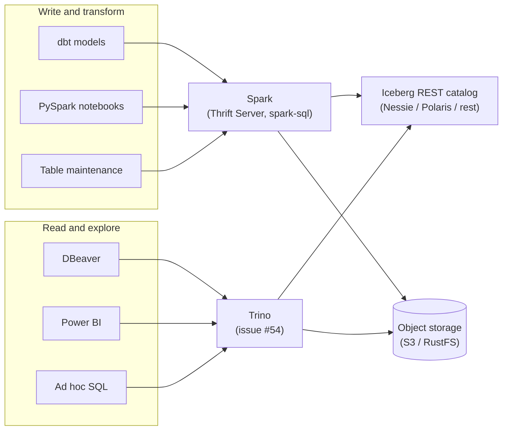

# Spark and Trino on the Iceberg catalogs — roles, overlap and dbt

- Date: 2026-11-11
- Status: analysis (no change to the lab). Input for issue #54 (Trino as an optional SQL
  engine).
- Related: issue #50 (closed), `NOTES.md` F9, issue #53 (Power BI, approach 2).

## Evidence levels

This document mixes three kinds of statements. Each section says which kind it uses.

| Label | Meaning |
|---|---|
| **Verified in the lab** | Run on the lab stack; the result is recorded in `NOTES.md` or in an issue |
| **Read in the source** | Read in the source code of the project; not run |
| **General knowledge** | Known behaviour of the engines; not measured in this lab |

Terminology: "V1" and "V2" catalogs are the two generations of the **Spark catalog API**
(V1 = the built-in `SessionCatalog`, `spark_catalog`; V2 = DataSource V2 `CatalogPlugin`,
used by the Iceberg `SparkCatalog`). They are not Iceberg table format versions.

## 1. Starting point: the JDBC navigator limit of the Spark Thrift Server

Verified in the lab and read in the source (details in `NOTES.md` F9 and issue #50):

- The Spark 4.1 Thrift Server answers the JDBC metadata calls (`getSchemas`, `getTables`,
  `getColumns`) from the V1 session catalog only. The lab catalogs `nessie`, `polaris` and
  `rest` are V2 catalogs, so a navigator (DBeaver, Power BI) does not show them.
- SQL works: three-part names (`SELECT * FROM nessie.<namespace>.<table>`) and the URL with
  `spark.sql.defaultCatalog`.
- The Iceberg `SparkSessionCatalog` as `spark_catalog` does not solve the limit (spike of
  2026-11-11).
- Spark 4.3 solves the limit only in part (schemas, not tables).

An organization with an architecture like the lab (Spark and Trino on Iceberg REST catalogs)
connects DBeaver to Trino. Trino is **not** in the lab today; issue #54 adds it.

## 2. Two engines for different workloads

General knowledge.

| Aspect | Spark | Trino |
|---|---|---|
| Design goal | General distributed compute engine for long, heavy jobs | Interactive (MPP) SQL query engine for many concurrent users |
| Execution | Stages with materialized intermediate results (shuffle files) | Pipelined, in memory, no materialized stages by default |
| Failure of a worker | Retries only the lost tasks | Default: the whole query fails and must run again. Optional fault-tolerant execution (spooled exchange) retries tasks, at a cost in latency |
| Memory pressure | Spills to disk; slower, but completes | The query can fail when it exceeds the memory limits |
| Languages | SQL, Python/Scala DataFrames, ML libraries, streaming | SQL only |
| Typical latency | Seconds of overhead per job; good for minutes-to-hours jobs | Sub-second to seconds for interactive queries |
| Concurrency | The Thrift Server has one driver: a bottleneck with many clients | Built for many concurrent queries |
| Federation | Through extra data sources | Native: one query can join Iceberg with PostgreSQL, MySQL, etc. |
| JDBC metadata for clients | Limited to the V1 session catalog (section 1) | Each configured catalog is a JDBC catalog, with its schemas and tables |
| Iceberg writes | Yes (`INSERT`, `MERGE`, `CREATE TABLE AS`, DDL) | Yes (`INSERT`, `MERGE`, `CREATE TABLE AS`, DDL) |
| Iceberg maintenance | Stored procedures (`rewrite_data_files`, `expire_snapshots`, `remove_orphan_files`, …) | `ALTER TABLE ... EXECUTE optimize / expire_snapshots / remove_orphan_files` |

Both engines run SQL and both read and write Iceberg tables. The overlap is real. The
difference is the workload each engine is built for.

## 3. Why an architecture keeps both

General knowledge.

**Benefits:**

- **Workload isolation.** A heavy transformation job does not slow down the dashboards and
  the analysts, and the reverse.
- **Each engine sized for its job.** The batch engine is tuned for throughput and recovery;
  the interactive engine is tuned for latency and concurrency.
- **Low cost of the second engine on Iceberg.** The data is not inside an engine. It is on
  object storage in an open format, and the REST catalog (Nessie, Polaris) tells both engines
  where it is. A table written by Spark is visible to Trino at once: no copy, no export.

**Costs:**

- Two systems to operate: versions, configuration, resources, monitoring.
- Two SQL dialects. Spark SQL and Trino SQL are similar but not equal (functions, types,
  some syntax). A query does not always move from one engine to the other unchanged.
- Two access points to govern. A catalog with central access control (Polaris RBAC) keeps
  the rules in one place for both engines. Nessie in the lab has no authentication
  (`NOTES.md` F2).

**When one engine is enough:**

- Small or medium data, few users, simple transformations: Trino alone (it can write Iceberg
  and run dbt models with dbt-trino).
- Batch and data science only, no interactive BI: Spark alone.
- Both engines are useful when heavy jobs and many interactive users exist at the same time.

Proposed roles in the lab (to confirm in the brainstorming of #54): Spark writes and
transforms; Trino reads and explores. Section 4 discusses a different split for dbt.

## 4. dbt on Trino instead of the Spark Thrift Server

General knowledge, except where marked.

dbt does not execute the models. It sends SQL statements (`CREATE TABLE AS`, `MERGE`,
`INSERT`) to the engine, and the engine does the work. dbt models are already batch work.
The question is which engine suits which model.

**Where Trino is probably faster:**

- Small and medium models (views, staging tables, aggregations on data that fits in memory):
  less overhead per statement, no materialized stages.
- Projects with many small models: the total time depends more on the overhead per
  statement than on the computation.
- Parallel models (dbt `threads`): the single driver of the Spark Thrift Server is a
  bottleneck; Trino handles many concurrent queries.

**Where Spark stays the better fit:**

- Heavy models: joins of very large tables, `MERGE` into tables with billions of rows. They
  can exceed the memory limits of Trino; with the default configuration the query fails and
  runs again from the start. Spark spills to disk and completes.
- Transformations that SQL does not express well: Python logic, ML.

**Constraint: one adapter per dbt target.** One `dbt run` uses one adapter. A single run
cannot send some models to Trino and others to Spark. A split needs one of these designs:

1. Two dbt projects (dbt-trino and dbt-spark) on the same Iceberg tables.
2. dbt-trino for the models, and Spark outside dbt (PySpark jobs or `spark-submit`, run by
   an orchestrator) for the heavy batch jobs and the table maintenance.

With Iceberg and a shared catalog, both sides see the same tables. The cost is two SQL
dialects and two places where the transformation logic lives.

**Lab specifics (verified in the lab):**

- The lab dbt project uses dbt-spark with `method: thrift` for the three targets
  (`dbt/profiles.yml`). The incremental model `fct_lineitem` uses `merge` (`NOTES.md` F8).
- The `make elt-test` timings (`NOTES.md` F8) use `SF=0.01`. They measure overhead, not
  engine performance. They give no data for this comparison.
- The separate project `dbt-lab-iceberg` and the Power BI approach 1 (issue #53) also use the
  Spark Thrift Server. The Thrift Server is already optional (profile `thrift`).

**Summary:** dbt-trino is a valid choice for most "normal" models, and often faster than the
Spark Thrift Server. Spark stays for models that are too heavy for Trino and for non-SQL work.
The boundary between the two depends on the data volumes; it is not known yet.

## 5. Proposed experiment (for issue #54)

Not done. To discuss in the brainstorming of #54.

1. Port the lab dbt project to dbt-trino (a second target or a second project), with the
   same models and the same incremental strategy (`merge`).
2. Run both versions on the same TPC-H data at two scales (for example `SF=1` and `SF=10`).
3. Measure for each model: run time, failures, memory errors.
4. Record the SQL changes needed between the Spark and Trino dialects.
5. Check the DBeaver navigator on Trino (catalogs, schemas, tables).

Expected output: lab data on where the boundary between Trino and Spark lies for the dbt
models, instead of general rules.

## 6. Open questions

- Trino version and licence check (Trino is Apache-2.0; #53 used Trino 484).
- Storage access of Trino on AWS (VM role) and on the RustFS variant.
- Polaris credentials for Trino (`polaris-setup` output; no secret in tracked files).
- Nessie: Trino through the Iceberg REST endpoint of Nessie, like Spark.
- Fault-tolerant execution in Trino: needed for the heavy models of the experiment or not.
- Whether to keep the Spark Thrift Server after #54 (current answer: yes, for dbt-spark,
  `dbt-lab-iceberg` and Power BI approach 1).
