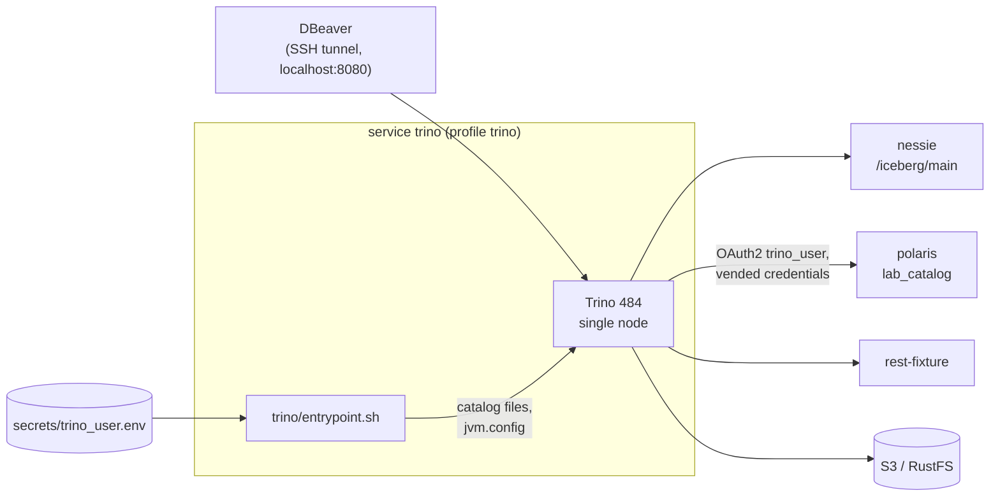

# Trino as an optional SQL engine on the Iceberg REST catalogs — design

- Date: 2026-11-11
- Issue: #54
- Parent spec: `docs/superpowers/specs/2026-10-28-iceberg-catalog-lab-design.md`
- Input: `docs/analysis/2026-11-11-spark-and-trino.md`, issue #53 (approach 2), `NOTES.md` F9
- Status: approved in brainstorming session

## 1. Goal

Add Trino to the lab as an optional SQL engine on the Iceberg REST catalogs `nessie`,
`polaris` and `rest`. A JDBC client (DBeaver) connected to Trino shows the catalogs, the
namespaces and the tables in its navigator. The Spark Thrift Server cannot do this
(`NOTES.md` F9).

Trino reads and writes the same Iceberg tables as Spark. A table written by one engine is
visible to the other engine at once.

## 2. Scope

In scope:

- The service `trino` (profile `trino`) and the configuration of the three catalogs.
- A dedicated Polaris principal `trino_user`.
- The AWS stack and the RustFS variant.
- Tests: generated configuration, live service, static checks.
- A manual check of the DBeaver navigator.
- Documentation: `README.md` (with a memory table), `NOTES.md`, `VERSIONS.md`, `.env.example`.

Out of scope:

- The dbt-spark versus dbt-trino experiment (analysis section 5). Issue #55 tracks it.
- Authentication and TLS for Trino. They are necessary only for Power BI (issue #53).
- Power BI.
- A multi-node Trino cluster and fault-tolerant execution.

## 3. Decisions taken in the brainstorming session

| # | Decision | Rejected alternatives |
|---|---|---|
| 1 | Issue #54 covers the Trino service, the catalogs, the tests, the DBeaver check and the documentation. The dbt-trino experiment goes to issue #55 | Experiment in #54; a dbt `trino` target without measurements |
| 2 | HTTP on port 8080, no authentication, published on `127.0.0.1` only. Access from a workstation goes through the SSH tunnel | HTTPS with a password file now; HTTP with file-based access control and no authentication |
| 3 | Trino reads and writes on all catalogs. Polaris: dedicated principal `trino_user` with full permissions | Read-only Trino (`iceberg.security=read_only`) with a read-only principal; reuse of `spark_user` |
| 4 | Memory: `TRINO_MEM_LIMIT` (default `3g`) and `TRINO_HEAP` (default `2g`) in `.env`. `README.md` has a memory table per service with the recommended combinations for 8 GB and for 16 GB or more | Fixed values in the Compose file; 6 GB default |
| 5 | Configuration through an entrypoint wrapper on the official image. Catalog files use `${ENV:NAME}` for secrets | Custom image with a `Dockerfile`; dynamic catalogs (`CREATE CATALOG`) created by a setup job |
| 6 | Nessie through its Iceberg REST endpoint (`/iceberg/main`), like Spark | Native Trino `nessie` catalog type (no views, separate authentication model) |
| 7 | Trino catalog names are equal to the Spark catalog names: `nessie`, `polaris`, `rest` | Other names |

## 4. Facts (checked on 2026-11-11)

- Trino 484 (2026-10-16) is the latest release (GitHub releases of `trinodb/trino`).
  License: Apache-2.0. The image `trinodb/trino` contains Java 25 and the `trino` CLI.
- Trino loads its catalogs at startup. A catalog whose REST service is off makes the
  startup fail. For this reason only the catalogs that are on get a file.
- Trino replaces `${ENV:NAME}` in the configuration files with the value of the environment
  variable `NAME`. A secret therefore stays in the process environment and not in a file.
- The Iceberg connector of Trino uses its own S3 file system (`fs.native-s3.enabled=true`),
  not the Iceberg `FileIO`. The S3 settings that Spark receives from a catalog (for example
  the endpoint that Nessie gives to clients) must be set explicitly for Trino.
- Polaris credential vending for Trino: `iceberg.rest-catalog.vended-credentials-enabled=true`.
- The Trino JDBC driver answers `DatabaseMetaData.getSchemas` and `getTables` with queries on
  `system.jdbc.schemas` and `system.jdbc.tables`. A SQL query on these tables gives the same
  data that the DBeaver navigator shows.

Points that issue #53 marked NOT CONFIRMED. The live test (section 9.2) checks them:

1. Polaris with OAuth2 and vended credentials (AWS STS and RustFS STS).
2. Nessie through `rest` at `/iceberg/main`.
3. The `rest` fixture 1.10.1.
4. Trino 484 reads Iceberg 1.11.0 tables written by Spark 4.1.3.

When a point fails, stop. Find the cause and record the result in `NOTES.md`. Do not force
a workaround without a decision of the user.

## 5. Architecture



## 6. Service and configuration

### 6.1 Compose service `trino`

In `docker-compose.yml`:

- `image: ${TRINO_IMAGE}` (`trinodb/trino:484`).
- `profiles: [trino]`.
- `user: "${LAB_UID:-1000}"`: `polaris-setup` writes `secrets/trino_user.env` with this UID
  and mode `600`. See section 6.5 for the risk.
- `mem_limit: ${TRINO_MEM_LIMIT:-3g}`.
- `environment`: `LAB_CATALOGS: ${COMPOSE_PROFILES:-}`, `TRINO_HEAP: ${TRINO_HEAP:-2g}`,
  `AWS_REGION`, `S3_ENDPOINT`, `S3_PATH_STYLE_ACCESS`, `AWS_ACCESS_KEY_ID`,
  `AWS_SECRET_ACCESS_KEY` (empty on AWS).
- `depends_on`: the same entries as `spark` (`nessie`, `polaris-setup`, `rest-fixture`,
  each with `required: false`). Trino starts after the catalogs that are on are ready and
  after `polaris-setup` has written the credentials.
- `entrypoint: ["/lab/entrypoint.sh"]`.
- `volumes`: `./trino:/lab:ro`, `./secrets:/run/lab-secrets:ro`.
- `ports`: `127.0.0.1:8080:8080`.
- `healthcheck`: `GET http://127.0.0.1:8080/v1/info` returns `"starting":false`.

Trino runs as a single node (coordinator and worker in one process), like the image
default. The entrypoint writes the complete configuration to a directory that the container
user can write (`/tmp/trino-etc`), because `/etc/trino` belongs to the image user `trino`
(section 6.5).

### 6.2 Entrypoint `trino/entrypoint.sh`

The script:

1. Reads `LAB_CATALOGS` (comma-separated profiles). Ignores `thrift` and `trino`. Maps the
   profile `baseline` to the catalog `rest`. Prints a warning for an unknown profile and for
   `*`.
2. Writes each catalog that is on to `/tmp/trino-etc/catalog/<catalog>.properties`, from
   `/lab/catalog/<catalog>.properties`.
3. When `S3_ENDPOINT` is set, appends `/lab/catalog-s3-endpoint/<catalog>.properties`
   (section 7.2).
4. When `polaris` is on, sources `/run/lab-secrets/trino_user.env` and exports
   `POLARIS_TRINO_CLIENT_ID` and `POLARIS_TRINO_CLIENT_SECRET`. When the file is missing, it
   prints a clear error and exits with a non-zero code.
5. Writes `jvm.config` with `-Xmx${TRINO_HEAP}` and the JVM options of the image default.
6. Writes `config.properties` (single node: `coordinator=true`,
   `node-scheduler.include-coordinator=true`, `http-server.http.port=8080`,
   `discovery.uri=http://localhost:8080`) with the memory limits of section 6.4, and
   `node.properties` with a writable `node.data-dir`.
7. With arguments: runs them (for the configuration test, section 9.1). Without arguments:
   starts Trino with `/tmp/trino-etc` as configuration directory (the `launcher` option
   `--etc-dir`; the implementation checks the start command of the image).

The script is bash with `set -euo pipefail` and passes `shellcheck`. It writes only to
directories in the container; it never writes a secret to a file.

### 6.3 Catalog files `trino/catalog/`

Common lines in each file:

```properties
connector.name=iceberg
iceberg.catalog.type=rest
fs.native-s3.enabled=true
s3.region=${ENV:AWS_REGION}
```

Per catalog:

| Catalog | Lines |
|---|---|
| `nessie` | `iceberg.rest-catalog.uri=http://nessie:19120/iceberg/main` |
| `rest` | `iceberg.rest-catalog.uri=http://rest-fixture:8181` |
| `polaris` | `iceberg.rest-catalog.uri=http://polaris:8181/api/catalog`, `iceberg.rest-catalog.warehouse=lab_catalog`, `iceberg.rest-catalog.security=OAUTH2`, `iceberg.rest-catalog.oauth2.credential=${ENV:POLARIS_TRINO_CLIENT_ID}:${ENV:POLARIS_TRINO_CLIENT_SECRET}`, `iceberg.rest-catalog.oauth2.scope=PRINCIPAL_ROLE:ALL`, `iceberg.rest-catalog.oauth2.server-uri=http://polaris:8181/api/catalog/v1/oauth/tokens`, `iceberg.rest-catalog.vended-credentials-enabled=true` |

The implementation checks each property name against the Trino 484 documentation
(context7). If a name differs, the documentation wins and the spec gets a note.

### 6.4 Memory

- `TRINO_MEM_LIMIT` (default `3g`): the container limit.
- `TRINO_HEAP` (default `2g`): the JVM heap.
- The entrypoint derives `query.max-memory-per-node` and `query.max-memory` from
  `TRINO_HEAP` with a fixed fraction (the implementation documents the fraction). The user
  changes one variable for the heap; the query limits follow.

### 6.5 Risk: the container user

The image runs Trino as the user `trino` (UID 1000). The lab runs the container with
`LAB_UID`, so that Trino can read `secrets/trino_user.env` (mode `600`, owner `LAB_UID`).
The first task of the plan checks that the image starts with an arbitrary UID, with the
configuration in `/tmp/trino-etc` and `node.data-dir` in a writable directory. If the image does not accept an
arbitrary UID, stop and choose another solution with the user. Record the result in
`NOTES.md`.

### 6.6 Makefile

- Target `sql-trino`: `docker compose exec trino trino`.

## 7. Storage access

### 7.1 AWS (default stack)

- No static key. The Trino S3 client uses the AWS default credential chain: the VM
  instance profile through IMDSv2. Same model as `nessie` and `rest-fixture`.
- `nessie` and `rest`: Trino reads and writes the files with the VM role. The role already
  allows the prefixes `nessie/` and `rest/`. No IAM change.
- `polaris`: the VM role does not allow the prefix `polaris/`. Trino uses the credentials
  that Polaris vends through STS (role `polaris-s3-access`). Same path as Spark. No IAM
  change.

### 7.2 RustFS variant

- Directory `trino/catalog-s3-endpoint/`, one fragment per catalog. The entrypoint appends
  the fragment when `S3_ENDPOINT` is set. Same pattern as `spark/conf/s3-endpoint/`.
  Trino rejects an empty `s3.endpoint`, so the lines cannot be in the common file.
- `nessie` and `rest` fragments: `s3.endpoint=${ENV:S3_ENDPOINT}`,
  `s3.path-style-access=${ENV:S3_PATH_STYLE_ACCESS}`,
  `s3.aws-access-key=${ENV:AWS_ACCESS_KEY_ID}`, `s3.aws-secret-key=${ENV:AWS_SECRET_ACCESS_KEY}`
  (keys of the RustFS user `lab`).
- `polaris` fragment: `s3.endpoint` and `s3.path-style-access` only. The keys come from
  credential vending (RustFS STS).
- `docker-compose.rustfs.yml` adds to `trino` the same overrides as `spark`:
  `depends_on: rustfs-setup`, `S3_ENDPOINT: http://rustfs:9000`, `S3_PATH_STYLE_ACCESS: "true"`,
  the keys of the user `lab`, and the volume `./secrets/rustfs:/run/lab-secrets:ro`.

## 8. Polaris principal `trino_user`

Changes to `polaris/setup/setup.sh` (idempotent, POSIX `sh`):

- New function `ensure_principal NAME FILE PREFIX`. It contains the current logic for
  `spark_user`: create the principal; if it exists, keep the file when a token call works;
  else reset the credentials and write the file. `PREFIX` gives the variable names
  (`POLARIS_SPARK` or `POLARIS_TRINO`). The script calls the function for `spark_user`
  (`spark_user.env`) and `trino_user` (`trino_user.env`).
- New principal role `trino_role`, assigned to `trino_user`.
- The existing catalog role `lab_admin` (`CATALOG_MANAGE_CONTENT` on `lab_catalog`) is
  assigned to `trino_role`.
- The reset message names both services: `docker compose restart spark` for `spark_user`,
  `docker compose restart trino` for `trino_user`.
- The script creates `trino_user` always, also when the profile `trino` is off. The script
  does not need to know which engines are on.

The existing test `tests/polaris-service.sh` covers the refactoring. It gets checks for
`trino_user` and `trino_user.env`.

## 9. Tests

### 9.1 `tests/trino-config.sh` — generated configuration

Model: `tests/spark-config.sh`. The test runs `docker compose run --rm --no-deps -T trino`
with different values of `LAB_CATALOGS` and `S3_ENDPOINT`, and reads the files in
`/tmp/trino-etc/`. The catalogs do not need to run. For `polaris`, the test gives a dummy
`trino_user.env` (test values, not secrets).

Checks:

- Only the catalogs that are on have a file. `baseline` gives `rest.properties`.
- `thrift` and `trino` give no file.
- With `S3_ENDPOINT`: the fragment is present. Without `S3_ENDPOINT`: no `s3.endpoint` line.
- `jvm.config` contains `-Xmx` equal to `TRINO_HEAP`.
- No catalog file contains a secret value: secrets appear only as `${ENV:...}`.
- `polaris` on and no `trino_user.env`: the entrypoint exits with a non-zero code and a
  clear message.

### 9.2 `tests/trino-service.sh` — live service

`tests/smoke-test.sh` runs it when the service `trino` is in the Compose configuration (same
pattern as `thrift-service.sh`). For each catalog that is on:

1. **Spark to Trino.** Spark creates the namespace `trino_check` and a table with one row.
   Trino reads the row with `SELECT`.
2. **Navigator data.** `system.jdbc.schemas` contains `trino_check` for the catalog.
   `system.jdbc.tables` contains the table.
3. **Trino to Spark.** Trino creates a table with `CREATE TABLE AS`. Spark reads it.
4. **Cleanup.** A `trap` drops the test tables and the namespace, also after a failed check.

Other checks:

- Port 8080 is published on `127.0.0.1` only.
- The Polaris catalog answers as `trino_user` (a token call with the credentials in the file).

### 9.3 Static checks

- `tests/lint.sh`: `shellcheck` covers `trino/entrypoint.sh`.
- `tests/compose-variant.sh`: checks the RustFS overrides of `trino`.
- `tests/check-no-secrets.sh`: covers the directory `trino/`.

### 9.4 Where the tests run

- 9.1 and 9.3: locally and on the EC2 VM.
- 9.2: on the EC2 VM, on the AWS stack and on the RustFS variant.

### 9.5 Manual check (user)

DBeaver with the Trino driver, through the SSH tunnel `-L 8080:127.0.0.1:8080`, URL
`jdbc:trino://localhost:8080`, any user name, no password. Expected result: the navigator
shows the catalogs that are on, their namespaces and their tables. The result goes to
`NOTES.md`.

## 10. Documentation

### 10.1 `README.md`

- A section "Trino": purpose (JDBC navigator, interactive SQL), how to turn it on (`trino`
  in `COMPOSE_PROFILES`), `make sql-trino`, the DBeaver connection step by step.
- A table "memory per service": the limit of each service (Spark driver, Thrift Server,
  Trino, Nessie, Polaris, rest fixture, Postgres, RustFS) and the recommended combinations:
  - **8 GB**: Trino with one catalog and without `thrift`; or `thrift` without Trino.
  - **16 GB or more**: all services on. Which values to increase for larger data
    (`TRINO_MEM_LIMIT`, `TRINO_HEAP`).
  - The symptoms when the memory is not sufficient: Docker stops the container (OOM, exit
    code 137), or Trino stops the query with a memory error.
- The two SQL access points: the Thrift Server for dbt-spark and Power BI approach 1; Trino
  for the JDBC navigator and interactive SQL.

### 10.2 `NOTES.md`

- D17: Trino HTTP without authentication on `127.0.0.1` (TLS and passwords deferred to
  Power BI, issue #53).
- D18: Trino reads and writes; dedicated Polaris principal `trino_user`.
- F10: results of the four NOT CONFIRMED points (section 4), the DBeaver navigator check,
  the container user check (section 6.5), and the memory observed on the VM.

### 10.3 `VERSIONS.md` and `.env.example`

- `VERSIONS.md`: Trino 484, source, license, verification date.
- `.env.example`: `TRINO_IMAGE=trinodb/trino:484`, `TRINO_MEM_LIMIT`, `TRINO_HEAP` (with a
  pointer to the memory table of `README.md`), and `trino` in the comment on
  `COMPOSE_PROFILES`.

## 11. Delivery

- Branch `feat/trino`. One PR closes #54.
- The spec and the plan are committed on the branch.
- Issue #55 tracks the dbt-spark versus dbt-trino experiment
  (`docs/analysis/2026-11-11-spark-and-trino.md`, section 5).
