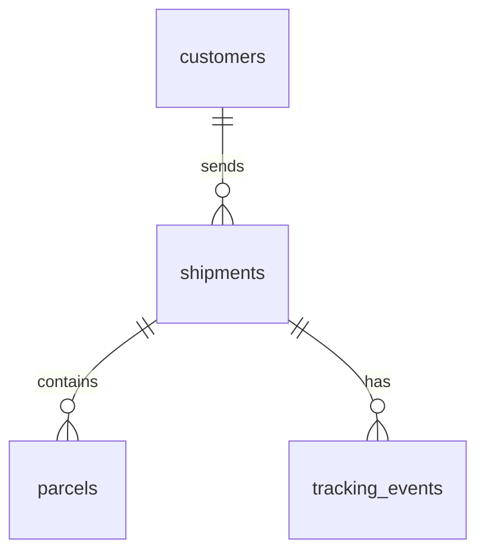

# Design — Extra JDBC sources for the lab Spark, and a SQL Server shipping source for dbt study

- Date: 2026-11-24
- Issue: to be opened (this spec)
- Status: approved by the user in the brainstorming of 2026-11-24

## 1. Goal

The user studies dbt with the dbt project `~/work/academy/dbt-iceberg-lab` (dbt-spark, method
`thrift`, catalog `nessie`). The user needs an operational source database to read from: a
small SQL Server database that simulates a shipping business. dbt-spark reads the source
directly through a Spark JDBC catalog and writes Iceberg tables on Nessie.

The lab gets a generic mechanism for this: a local directory with JDBC driver jars and extra
Spark configuration files. A new JDBC source then needs only a driver jar and one `.conf` file,
with no image change.

## 2. Scope

Two parts with different lifecycles.

**Part L — lab (committed: issue, branch `feat/extra-jdbc-sources`, PR):**

1. The local directory `local/` (git-ignored).
2. Mount of `${LAB_EXTRA_DIR:-./local/spark}` in `spark` and `spark-thrift`.
3. Driver jars on the Spark driver class path.
4. Extra Spark configuration files appended by the entrypoint.
5. `host.docker.internal` in `spark` and `spark-thrift`.
6. Test `tests/extra-dir.sh`, `README.md`, `.env.example`, `NOTES.md` (D21, F12).

**Part S — source and dbt files (local, never committed):**

1. `sqlserver-source/` in the dbt project: Compose project, SQL scripts, `run.sh`, manual.
2. `models/shipping/` in the dbt project: dbt sources and one smoke model.
3. `local/spark/jars/` and `local/spark/conf/mssql.conf` in the lab.

Part S is excluded from git in the dbt project through `.git/info/exclude` (not `.gitignore`),
so that no trace of it reaches the dbt project remote. In the lab it lives under `local/`.

Out of scope:

- Trino access to SQL Server (a Trino `sqlserver` catalog). Possible future exercise (#55).
- dbt staging, tests, incremental models and snapshots on the shipping data. The user writes
  them as exercises (see 5.6).
- Changes to the committed files of the dbt project (`dbt_project.yml`, `profiles.yml`).
- The wrong lab path `../iceberg-platform-poc` in the dbt project `CLAUDE.md`, README,
  `dbt_project.yml` and `requirements.txt`. Report to the user; fix in that repository
  separately.
- Regression on the `polaris` and `rest` catalogs (user decision, see 7.1).

## 3. Decisions taken in the brainstorming

| # | Decision | Reason |
|---|---|---|
| B1 | SQL Server runs in its own Compose project, outside the lab network | A source is an external system; the lab reaches it over the network |
| B2 | Lab containers reach it at `host.docker.internal:1433`; SQL Server publishes on the Docker bridge address `172.17.0.1:1433` | `127.0.0.1` on the host is not reachable from a container; the bridge address is not reachable from the internet |
| B3 | Generic lab directory `local/`, git-ignored, rule committed, documented in README | One place for installation-specific files, kept across sessions |
| B4 | `LAB_EXTRA_DIR` in `.env` selects the Spark extra directory; default `./local/spark` | The user can point it to another place |
| B5 | Source files live in the dbt project, excluded with `.git/info/exclude` | Source next to the dbt models that read it; the dbt project remote stays clean |
| B6 | Minimal data model: 4 tables | Enough for staging, joins and a fact; small to read |
| B7 | Data changes over time (deterministic script) and contains intended defects | Exercises for incremental models, snapshots and dbt tests |
| B8 | Approach 1: dbt-spark reads SQL Server directly through a Spark JDBC catalog | What the user asked; no extra load step |
| B9 | Fallback: approach 2 (Spark job copies to an Iceberg raw namespace, dbt reads Iceberg) | Only if the spike (6) fails; ask the user first |
| B10 | We write only dbt sources and one smoke model; the user writes the rest | The goal is to learn dbt |
| B11 | Manual in HTML with SVG diagrams | User rule: human-consumed documents are HTML |
| B12 | Regression on `nessie` only | Templates of the Iceberg catalogs do not change |

## 4. Part L — lab changes

### 4.1 Directory `local/`

- `.gitignore`: add `/local/`.
- `make up`: `mkdir -p` of `${LAB_EXTRA_DIR}/jars` and `${LAB_EXTRA_DIR}/conf` (default
  `local/spark`), as for `secrets/`. Reason: when Docker creates a missing bind-mount source,
  root owns it.

### 4.2 Compose (`spark` and `spark-thrift`)

```yaml
volumes:
  - ${LAB_EXTRA_DIR:-./local/spark}:/opt/lab-extra:ro
extra_hosts:
  - host.docker.internal:host-gateway
```

`.env.example`: `LAB_EXTRA_DIR` commented, with the default value and one line of explanation.

### 4.3 Driver jars

`spark/conf/spark-defaults.conf`:

```
spark.driver.extraClassPath    /opt/lab-extra/jars/*
```

Both services run Spark in local mode (one JVM, the driver), so the driver class path is
enough. An empty directory has no effect.

### 4.4 Extra configuration files

`spark/entrypoint.sh`: after the catalog templates, append every
`/opt/lab-extra/conf/*.conf`, in lexical order, as is (no template rendering).

- Directory missing or empty: skip, no message.
- Files without the `.conf` extension: ignored.
- The rendered file is already private (`umask 077`). `spark.redaction.regex` already hides
  passwords in the Spark UI.
- The image must be rebuilt once (the entrypoint is in the image); `make up` builds.

### 4.5 One catalog at a time (D20)

Unchanged. A JDBC catalog added through `conf/` is not an Iceberg catalog: it is a read-only
source. Record as `NOTES.md` D21.

### 4.6 README

New section "Local files and extra JDBC sources": purpose of `local/`, `LAB_EXTRA_DIR`, the
`jars/` + `conf/` layout, a SQL Server example `.conf`, `host.docker.internal`, restart of
`spark` and `spark-thrift` after a change, troubleshooting (`No suitable driver`).

## 5. Part S — SQL Server shipping source

Root: `~/work/academy/dbt-iceberg-lab/sqlserver-source/`.

### 5.1 Container (`compose.yaml`)

- Image `mcr.microsoft.com/mssql/server:2022-<exact tag>` (tag pinned in the plan).
- `ACCEPT_EULA=Y`, `MSSQL_PID=Developer`, `MSSQL_MEMORY_LIMIT_MB=2048`.
- Port `172.17.0.1:1433:1433` (the plan checks the address of `docker0`).
- Named volume for the data. Healthcheck with `sqlcmd`.
- Passwords in `sqlserver-source/.env` (local).

### 5.2 Logins

- `sa`: create and reset only.
- `dbt_reader`: login with `db_datareader` on `shipping`. Spark uses it.

### 5.3 Data model (database `shipping`, schema `dbo`)



| Table | Content | Initial rows (about) |
|---|---|---|
| `customers` | sender customers: name, email, country code, `updated_at` | 15 |
| `shipments` | customer, origin and destination city, service, status, promised date, `created_at`, `updated_at` | 30 |
| `parcels` | shipment, weight, dimensions | 50 |
| `tracking_events` | shipment, event type (picked up, in transit, at depot, out for delivery, delivered), event time, location, `loaded_at` | 91 |

T-SQL types: `INT IDENTITY`, `NVARCHAR`, `DATETIME2`, `DECIMAL`. Exact columns are fixed in the
plan and documented in the manual.

A control table `sim_clock` holds the current simulated day.

### 5.4 Intended defects (about 6)

| Defect | dbt answer |
|---|---|
| A duplicated tracking event | `unique` test on a key, dedup in staging |
| `customers.email` is `NULL` on one row | `not_null` test |
| Status spelled `DELIVERED`, `delivered`, `Delivered` | `accepted_values` test, normalisation in staging |
| A shipment without parcels | relationship check in a model or singular test |
| A parcel with weight 0 | singular test or expression test |
| A country code with trailing spaces | `trim` in staging |

### 5.5 Scripts

| Script | Purpose | Runs |
|---|---|---|
| `sql/01_schema.sql` | database, tables, `sim_clock` | once |
| `sql/02_seed.sql` | initial data with the defects | once |
| `sql/03_reader.sql` | login `dbt_reader` | once |
| `sql/advance_time.sql` | advance the simulated day by one | many times |
| `run.sh up\|init\|advance\|reset\|status\|down` | wrapper around `docker compose` and `sqlcmd`; `reset` runs the three init scripts again | — |

`advance_time.sql` is deterministic: it selects rows from the day number, never from random
values. Each run:

1. Advances `sim_clock` by one day.
2. Adds tracking events to the shipments in transit.
3. Moves some shipments to delivered; updates `status` and `updated_at`.
4. Creates 2 new shipments with parcels.
5. Every third day, inserts one late-arriving event (event time earlier than the previous
   load), to show the classic incremental-model pitfall.

### 5.6 Manual (`sqlserver-source/MANUAL.html`)

HTML with inline SVG diagrams. Content:

1. Data model diagram and column descriptions.
2. Spark type mapping (from the spike, 6.3).
3. Defects: where they are, which dbt test finds them.
4. What each simulated day changes, with the expected row counts.
5. `run.sh` commands; how to connect the lab (`local/spark`).
6. Exercises: staging, tests, incremental model, snapshot, source freshness.
7. Solutions, in a separate section.
8. Troubleshooting.

### 5.7 dbt files (`models/shipping/`, excluded)

- `_sources.yml`: source `shipping` with the 4 tables, descriptions, `loaded_at_field`; no
  tests.
- `shipping_smoke.sql`: reads `shipments`, writes an Iceberg table; schema `shipping_smoke`,
  set with `config()` in the file.

### 5.8 Lab connection (`local/spark/` in the lab)

- `jars/`: `mssql-jdbc` from Maven Central, version and SHA checksum pinned in the plan.
- `conf/mssql.conf`:

```
spark.sql.catalog.mssql           org.apache.spark.sql.execution.datasources.v2.jdbc.JDBCTableCatalog
spark.sql.catalog.mssql.url       jdbc:sqlserver://host.docker.internal:1433;databaseName=shipping;encrypt=true;trustServerCertificate=true
spark.sql.catalog.mssql.user      dbt_reader
spark.sql.catalog.mssql.password  <local secret>
```

## 6. Spike — dbt-spark sources on a non-default catalog

First task of the plan. Nothing else in Part S is written before it passes.

### 6.1 Spark only

With `spark-sql` in `spark-thrift`: `SHOW TABLES IN mssql.dbo`, `SELECT` with a `WHERE` (filter
pushdown), `DESCRIBE` of each table.

### 6.2 dbt

Try in order; stop at the first that works:

| # | Source definition | Expectation |
|---|---|---|
| a | `database: mssql`, `schema: dbo` | likely error: dbt-spark rejects `database` |
| b | `schema: mssql.dbo`, quoting off | likely works: renders `mssql.dbo.<table>` |
| c | a macro that overrides `source()` for this source | works; needs explanation |

If a, b and c fail: stop, ask the user, then switch to the fallback (B9).

### 6.3 Records

- Type mapping `DATETIME2`, `NVARCHAR`, `DECIMAL`, `BIT`, `INT IDENTITY` → Spark types.
- Startup of `spark-thrift` when SQL Server is down (expected: the JDBC catalog connects
  lazily; the Thrift Server must start).
- Result in `NOTES.md` F12 (F11 is reserved for issue #70).

## 7. Verification

### 7.1 Part L (catalog `nessie`, `COMPOSE_PROFILES=nessie,thrift`)

- `make lint`.
- New `tests/extra-dir.sh`: temporary directory with a probe file
  (`spark.lab.extra.probe ok`), `LAB_EXTRA_DIR` pointed to it, restart `spark`, check the
  value with `spark-sql` (`SET spark.lab.extra.probe`).
- Negative case: empty `local/spark`; `make smoke-test` and `tests/thrift-service.sh` pass.

### 7.2 Part S

- `run.sh init`; row counts equal the manual.
- `run.sh advance` twice; row counts equal the manual for day 1 and day 2.
- `run.sh reset`; row counts back to the initial values.
- `INSERT` as `dbt_reader` fails.

### 7.3 End to end

`spark-sql` on `mssql.dbo.*` → `dbt debug` → `dbt run -s shipping_smoke` → `run.sh advance` →
`dbt run -s shipping_smoke`; the new rows are in the Iceberg table.

Evidence for Part S goes in comments of the issue (no PR for Part S).

## 8. Error handling

| Case | Behaviour |
|---|---|
| `conf/` missing or empty | skipped, no message |
| file without `.conf` | ignored |
| `.conf` present, driver jar missing | queries on `mssql.*` fail with `No suitable driver`; documented |
| SQL Server down | lab starts; only queries on `mssql.*` fail (verified in 6.3) |
| `LAB_EXTRA_DIR` points to a missing path | `make up` creates it |

## 9. Risks

- **RAM** (EC2 VM, 7.7 GB): `spark` and `spark-thrift` have `spark.driver.memory 4g` each,
  SQL Server 2 GB. Use `COMPOSE_PROFILES=nessie,thrift` (no Trino) during this work.
- **Disk** (5.8 GB free): SQL Server image about 1.6 GB. Below 3 GB free, propose
  `docker builder prune` (3.9 GB reclaimable) to the user.
- **Spike failure**: fallback B9, with a user decision.
